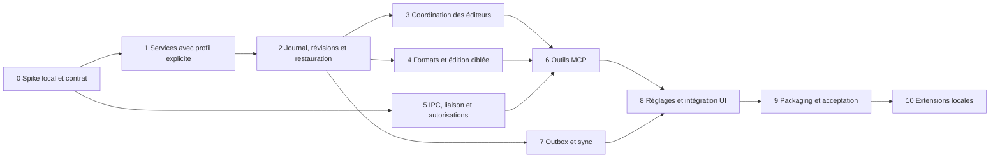

# MCP local pour Lexena — plan d'implémentation

> **For agentic workers:** REQUIRED SUB-SKILL: Use superpowers:subagent-driven-development (recommended) or superpowers:executing-plans to implement this plan task-by-task. Steps use checkbox (`- [x]`) syntax for tracking.

**Goal:** Donner à une IA locale un accès MCP aux notes et dossiers de Lexena, avec profils explicites, permissions révocables et écritures fiables, puis ouvrir progressivement les autres fonctions.

**Architecture:** Le serveur MCP Rust s'exécute dans Lexena et utilise ses services métier. Un exécutable stdio `lexena-mcp` communique avec lui par IPC privé Windows, sans port réseau. Un service commun aux commandes UI et au MCP fournit contrôle de concurrence, journal transactionnel et outbox par profil pour la sync existante.

**Tech Stack:** Rust, Tokio, SDK officiel `rmcp` publié et verrouillé après spike, Windows named pipes, coffre OS existant, React/TypeScript/TipTap, Vitest et tests Rust. Les bibliothèques HTML/Markdown/cryptographie sont sélectionnées et verrouillées au lot 0, sans implémenter ces primitives à la main.

**Spec:** [Conception MCP local](../specs/2026-11-05-local-mcp-design.md). Implémentation autorisée et réalisée sur `codex/local-mcp` ; les adaptations de contrat sont consignées dans [les décisions techniques](../../mcp/implementation-decisions.md).

## État de l'implémentation — 5 novembre 2026

| Lot | État constaté |
| --- | --- |
| Tâches 0 à 8 | Implémentées et relues, tests automatisés réussis. |
| Tâche 9 | Packaging et validations automatisées implémentés ; qualification d'installation, éditeurs natifs, nouveau PC et mise à jour signée encore ouverte. |
| Tâche 10 | Backlog hors V1 ; aucune extension ajoutée implicitement. |

Les suites finales comptent 711 tests frontend et 237 tests Rust réussis. [La checklist de livraison](../../mcp/e2e-checklist.md) distingue les mesures et essais réellement exécutés des scénarios manuels restants. Les étapes ci-dessous conservent le détail du plan approuvé ; leurs cases de validation ne remplacent pas cette preuve d'acceptation.

## Contraintes globales

- Connexion exclusivement locale au logiciel installé sur le PC ; aucun accès à distance.
- Chaque appel portant sur une note ou un dossier contient un `profile_id` local explicite et vérifié dans le manifeste et dans les droits de la connexion.
- Le profil actif dans l'interface n'est jamais un défaut implicite pour le MCP.
- Le serveur MCP ne modifie jamais `AppState.active_profile_id`.
- Aucun socket TCP, endpoint HTTP, port LAN ou tunnel.
- La fonction MCP et sa liaison sont distribuées avec Lexena pour tous les utilisateurs de la version compatible, sans runtime, compilation ou téléchargement technique supplémentaire.
- Le MCP est désactivé par défaut. Suppression et remplacement intégral sont désactivés par défaut.
- `operation_id` UUID fourni par le client, unique par connexion et intention, requis sur chaque mutation. Conserver les reçus 30 jours.
- Les timestamps restent destinés à la synchronisation existante, pas au contrôle de concurrence MCP.
- Aucun changement de schéma distant ni déploiement cloud nécessaire pour le socle MCP.
- Utiliser `pnpm tauri build` pour le build de production. Ne jamais lancer `pnpm tauri dev` automatiquement.
- Ne pas régénérer les clés de signature ni modifier la clé publique de l'updater.

## Points prioritaires de revue

1. Une frappe TipTap non sauvegardée ne doit pas être écrasée par un appel MCP : tâches 3 et 8, tests de course et brouillon conservé.
2. Un profil change ou disparaît pendant l'appel : tâche 1, validation/commit sous verrou et aucune réorientation vers le profil actif.
3. Un crash arrive après écriture disque mais avant réponse ou acquittement sync : tâches 2 et 7, rejeu idempotent et déduplication durable.
4. Une note riche ou de grande taille contient des images, liens et Unicode : tâches 4 et 6, fidélité HTML, limites en octets et lecture segmentée.
5. Un profil inactif reçoit un append puis un tombstone ou un pull distant : tâche 7, ordre de reprise et aucune résurrection involontaire.

## Découpage et dépendances

Les branches du diagramme représentent les dépendances logiques, pas une instruction de délégation simultanée. Les tâches 0 à 9 constituent la V1 ; la tâche 10 est un backlog séparé. Une préversion lecture seule peut être testée après 5/6, mais ne doit pas être présentée comme l'achèvement du besoin CRUD.

## Cartographie des fichiers

Nouveaux fichiers proposés ; les fichiers existants gardent leurs responsabilités publiques et délèguent progressivement :

| Zone | Fichiers | Responsabilité |
| --- | --- | --- |
| Services métier | `src-tauri/src/note_service/{mod,scope,repository,mutation}.rs` | Profils validés, accès disque, opérations communes notes/dossiers. |
| Durabilité | `src-tauri/src/note_service/{journal,versions,outbox}.rs` | Transactions, révisions, snapshots, intentions de sync et reçus. |
| Édition | `src-tauri/src/note_service/{editors,content}.rs` | Coordination des éditeurs et conversion/validation du contenu. |
| Serveur | `src-tauri/src/mcp/{mod,server,tools,contract,error}.rs` | SDK, outils typés, schémas et erreurs. |
| Autorisations | `src-tauri/src/mcp/{connections,permissions,audit}.rs` | Connexions, coffre, grants et journal d'activité. |
| IPC partagé | `src-tauri/crates/mcp-ipc/Cargo.toml`, `src-tauri/crates/mcp-ipc/src/{lib,auth,frame,windows}.rs` | Flux privé et preuve mutuelle ; aucune donnée métier. |
| Liaison | `src-tauri/crates/mcp-bridge/Cargo.toml`, `src-tauri/crates/mcp-bridge/src/main.rs` | Entrée stdio, connexion locale, diagnostics stderr. |
| Commandes UI | `src-tauri/src/commands/mcp.rs`, `src-tauri/src/commands/note_editors.rs` | Administration locale et handshake des éditeurs, non exposés par MCP. |
| Frontend | `src/lib/mcp/{types,client}.ts`, `src/hooks/useMcpSettings.ts`, `src/components/settings/sections/McpSection.tsx` | Configuration, permissions et état local. |
| UI et sync | `src/lib/notes/editor-ownership.ts`, `src/lib/sync/local-outbox.ts`, `src/hooks/useNoteChanges.ts` | Révisions dans les éditeurs, rafraîchissement et reprise sync. |
| Persistance queue | `src-tauri/src/sync_queue.rs` | Snapshot atomique queue/DLQ/watermark par profil, propriétaire unique de ce fichier. |
| Packaging | `scripts/build-mcp-bridge.mjs`, `src-tauri/binaries/` | Binaire de liaison par target, inclus au bundle. |
| Validation | Tests à côté des modules, `src-tauri/tests/local_mcp.rs`, `docs/mcp/README.md`, `docs/mcp/e2e-checklist.md`, `docs/mcp/tool-catalog.json` | Contrat et validation locale reproductibles. |

Stockage local ajouté sous l'app-data : `mcp/connections.json` (métadonnées sans secret), `mcp/endpoint.json` (descripteur de l'unique installation active du compte OS), `mcp/audit/`, et `profiles/<id>/note-service/` contenant journal, reçus, outbox et versions. Le secret reste dans le coffre OS. Ces fichiers ne sont pas ajoutés aux payloads sync ni aux exports publics ; le contenu des notes conserve le stockage existant.

## Tâche 0 — Valider le chemin technique et figer le contrat

**Fichiers :** créer `docs/mcp/implementation-decisions.md`, compléter la conception ; prototype jetable hors du code produit final dans un répertoire temporaire du workspace.

**Interfaces produites :** version publiée de `rmcp`, features exactes, format/version du handshake IPC, stratégie de build de la liaison et liste des plateformes réellement couvertes.

- [x] Faire un spike jetable `client stdio → liaison → named pipe → rmcp` avec un outil `ping` sans données utilisateur ; vérifier une requête et deux clients simultanés.
- [x] Vérifier la négociation des versions MCP 2026-07-28 et 2025-11-25 avec le SDK publié, et l'absence totale de logs sur stdout. Consigner les features Cargo réellement nécessaires.
- [x] Choisir et verrouiller les crates maintenues pour parsing DOM HTML, rendu Markdown, CSPRNG, HMAC/SHA-256, comparaison constante et remplacement de fichier Windows. Vérifier licences, MSRV et compatibilité TipTap sur un corpus synthétique ; aucune dépendance flottante Git.
- [x] Définir les fixtures de contrat : profil `perso`, profil `work`, note de même titre dans chacun, notes riches, local-only et note supprimée. N'utiliser aucune donnée réelle.
- [x] Valider le nom et l'emplacement installé du binaire `lexena-mcp`, les conventions target de Tauri et la mise à jour coordonnée avec Lexena. Le build actuel est porté par `scripts/release.ps1` ; `release.yml` génère les manifestes/scanne les artefacts, sans compilation. Le script publie un EXE portable seul : conserver cet artefact et ajouter un ZIP MCP des deux exécutables avec manifeste de version commune.
- [x] Documenter les résultats, versions et limites dans `implementation-decisions.md`. Le spike est supprimable et ne remplace pas les tâches suivantes. Commit proposé : `docs: define local MCP implementation contracts`.

**Sortie vérifiable :** transcript synthétique d'un aller-retour stdio, aucune écoute réseau, versions choisies et décision de packaging écrites. Si le SDK ne préserve pas la compatibilité souhaitée, fixer explicitement les clients supportés avant la tâche 5.

## Tâche 1 — Extraire des services ciblant un profil explicite

**Fichiers :** créer `note_service/{mod,scope,repository,mutation}.rs` ; modifier `notes.rs`, `folders.rs`, `profiles.rs`, `commands/profiles.rs`, `lib.rs` ; tests unitaires `note_service/scope.rs` et `repository.rs`.

**Interfaces :** `ProfileScope { local_id: String, root: PathBuf }` à constructeur privé ; `ProfileScope::resolve(app, profile_id) -> Result<ProfileScope, DomainError>` ; `NoteRepository::{list,get}` et `FolderRepository::{list,get}` reçoivent `&ProfileScope` ; `NoteService::mutate(scope, intent, actor) -> Result<MutationResult, DomainError>`. Les entrées publiques capturent le scope une fois.

- [x] Écrire les tests `explicit_work_does_not_touch_active_perso`, `rename_keeps_scope_id`, `deleted_profile_cannot_commit`, `reject_unknown_profile`, `reject_path_traversal_and_reparse_escape` et `folder_must_belong_to_note_profile`. Vérifier le refus et l'absence de fichier créé hors du profil attendu.
- [x] Exécuter `cargo test --manifest-path src-tauri/Cargo.toml --no-default-features note_service` ; observer les échecs pertinents avant extraction.
- [x] Déplacer l'I/O métier vers les repositories sans changer le format sur disque. Ajouter un verrou par profil, partagé par lectures, toutes les mutations UI, imports backup/distants, purge et suppression de profil. Ordre de verrouillage unique : registre des profils, puis profil ; ne pas conserver un verrou synchrone au travers d'un await frontend.
- [x] Faire déléguer les commandes existantes au service, en conservant leurs contrats pendant la transition. Le manifeste et la suppression de profil doivent coordonner le commit ; tester un `switch_profile` concurrent sans changer la cible d'un appel déjà capturé. Cette compatibilité transitoire ne vaut pas pour les sauvegardes différées : la tâche 3 les migre toutes vers un contexte de session explicite avant activation du MCP.
- [x] Rejouer les tests notes/folders/profiles existants et les nouveaux. Commit proposé : `refactor: add profile-scoped note services`.

**Sortie vérifiable :** l'UI continue à travailler sur son profil, le service peut travailler sur work pendant que perso reste affiché, aucun passage temporaire par `switch_profile`.

## Tâche 2 — Révisions, journal, idempotence et restauration

**Fichiers :** créer `note_service/{journal,versions,outbox}.rs`, compléter `mutation.rs` ; adapter `notes.rs`, `folders.rs` et les types frontend de notes/folders avec des champs de révision rétrocompatibles.

**Interfaces :** `MutationRequest { operation_id, expected_revision, intent }` ; `MutationResult { profile_id, entity_id, revision, operation_id, sync_state, snapshot_id }` ; `Revision` opaque ; `Journal::recover_profile(scope)` ; `VersionStore::{list,restore}` ; `LocalOutbox::{list_pending,ack}`. Une collection possède aussi une révision pour les curseurs.

- [x] Écrire `stale_revision_leaves_content_unchanged`, `replayed_append_returns_same_result`, `same_operation_different_payload_is_rejected`, `replay_checks_receipt_before_expected_revision`, `revoked_actor_cannot_replay_receipt` et `restore_after_tombstone_purge`.
- [x] Ajouter les tests d'injection de panne aux frontières journal fsync / contenu / métadonnées / reçu / outbox. Après récupération, les deux fichiers doivent décrire le même état et un rejeu doit produire exactement un ajout. Tester la suppression d'un dossier contenant plusieurs notes : journaliser son tombstone et tous les détachements dans une même transaction multi-entité, avec révisions et intentions sync ; après panne au milieu, toutes les notes sont conservées et finissent à la racine.
- [x] Exécuter le filtre `note_service` et constater les échecs. Implémenter un journal versionné, borné, avec commit/reprise et écritures atomiques adaptées à Windows. Un journal durable contient assez d'information pour refaire la mutation et son reçu sans duplication ; servir le profil seulement après récupération.
- [x] Initialiser paresseusement les révisions des anciens fichiers ; les révisions locales ne partent pas dans les payloads cloud. Toutes les mutations, imports compris, passent par la même invalidation de révision. Ne pas modifier les règles LWW existantes.
- [x] Implémenter les snapshots préalables aux modifications MCP, rétention 30 jours et plafond 268 435 456 octets par profil. Tester `history_full_rejects_before_mutation`, `expired_snapshot_is_not_restorable`, `restore_refuses_active_note` et la préservation de `local_only`. Restaurer un objet absent nécessite une révision d'absence/tombstone vérifiée sous verrou, pas un joker « force ».
- [x] Vérifier les tests de panne et le redémarrage synthétique. Commit proposé : `feat: make note mutations recoverable and idempotent`.

**Sortie vérifiable :** ni crash ni perte de réponse ne produisent un état partiel ou un append doublé. Les mécanismes de compaction ne suppriment ni un reçu de moins de 30 jours ni une intention sync non acquittée.

## Tâche 3 — Coordonner les éditeurs et les écritures externes

**Fichiers :** créer `note_service/editors.rs`, `commands/note_editors.rs`, `src/lib/notes/editor-ownership.ts` et tests associés ; modifier `useNotesEditorInstance.ts`, `useNotes.ts`, `useDetachedNote.ts`, `useDetachedNotesBridge.ts`, les types `NoteData` et les commandes de sauvegarde ; enregistrer les commandes dans `commands/mod.rs` et `lib.rs`.

**Interfaces :** `EditorContext { profile_id, note_id, session_generation, editor_id }` ; `begin_note_edit(context, base_revision)` ; `prepare_external_mutation(scope, note_id) -> Result<EditPermit, DomainError>` ; `ack_editor_prepare(context, prepare_id, revision, dirty)` ; `end_note_edit(context)` ; chaque lecture et sauvegarde UI transporte `EditorContext`, la sauvegarde ajoutant `expected_revision`. `EditPermit` expire en 2 s et ne contient pas de verrou bloquant un thread UI.

- [x] Écrire les tests Rust et Vitest `dirty_editor_blocks_mcp`, `clean_editor_pauses_then_reloads`, `late_keystroke_preserves_draft`, `stale_autosave_cannot_overwrite_mcp`, `detached_editor_obeys_same_protocol`, `unresponsive_editor_is_busy` et `late_save_after_profile_switch_rejects_even_with_same_note_uuid`.
- [x] Exécuter le filtre Rust `note_service` et `pnpm exec vitest run src/lib/notes/editor-ownership.test.ts` pour voir les échecs.
- [x] Enregistrer profil/note/révision/propriétaire/génération de session à l'ouverture. Invalider la génération dans `commands/profiles.rs::switch_profile` avant le reload ; ne jamais réinterpréter une lecture ou sauvegarde tardive selon le nouveau profil actif. Marquer dirty au premier `onUpdate` TipTap avant le timer 500 ms ; conserver le buffer jusqu'à confirmation de sauvegarde. Remplacer les appels de sauvegarde aveugles par une comparaison de révision ; afficher et conserver le brouillon en cas de conflit.
- [x] Implémenter préparation/acquittement/reprise pour un éditeur propre, refus pour un éditeur dirty et annulation sans effet après 2 s. Une frappe concurrente non encore acquittée ne peut pas faire perdre son buffer : elle produit un conflit si la mutation externe a gagné la sérialisation.
- [x] Couvrir fermeture, crash de WebView, changement de profil et plusieurs fenêtres. Restreindre l'administration MCP à la fenêtre principale ; les commandes d'ownership restent utilisables par les éditeurs concernés avec validation côté Rust.
- [x] Rejouer les tests détachés existants et les nouveaux. Commit proposé : `feat: protect open note editors from external conflicts`.

## Tâche 4 — Formats lisibles et édition ciblée sans perte

**Fichiers :** créer `note_service/content.rs` et corpus `src-tauri/tests/fixtures/mcp-notes/` ; ajouter un test de parité de titre dans `src/lib/notes/`.

**Interfaces :** `render_input(content, format) -> Result<HtmlFragment, DomainError>` ; `append_html(existing, fragment) -> Result<String, DomainError>` ; `replace_unique_text(html, old_text, new_text) -> Result<String, DomainError>` ; `read_view(html, format) -> NoteView { content, lossy, warnings }` ; `derive_note_title(html, locale) -> String`.

- [x] Écrire `append_keeps_existing_rich_html`, `replace_requires_one_text_node_match`, `replacement_escapes_markup`, `markdown_loss_is_reported`, `rejects_active_html_and_local_urls`, `preserves_tiptap_tasks_tables_links_images` et `title_matches_frontend_fixtures`.
- [x] Vérifier les échecs ; implémenter les conversions avec les crates validées au spike. Aucun traitement HTML par regex pour les mutations. Préserver le HTML existant lors de l'append et refuser un remplacement ciblé ambigu ou traversant plusieurs nœuds.
- [x] Fixer le sous-ensemble Markdown accepté dans `docs/mcp/README.md`, ainsi que les attributs TipTap conservés. Le remplacement intégral valide l'HTML complet et exige la permission distincte ; un document non supporté n'est pas « nettoyé » avec pertes silencieuses.
- [x] Tester contenu produit à 3 145 728 octets et à 3 145 729 octets, emojis coupés à une frontière de page, image base64 volumineuse et note existante au-delà du cap de mutation. Les lectures restent possibles ; les mutations trop grandes échouent avant journalisation.
- [x] Exécuter les tests de contenu Rust et de parité TS. Commit proposé : `feat: add safe MCP note content operations`.

## Tâche 5 — IPC privé, programme stdio et permissions

**Fichiers :** créer les crates `mcp-ipc`, `mcp-bridge`, les modules `mcp/{mod,connections,permissions,audit}.rs` et `commands/mcp.rs` ; modifier `Cargo.toml`, `Cargo.lock`, `lib.rs` et `commands/mod.rs`. Pas de listener réseau.

**Interfaces :** `ConnectionGrant { id, name, profile_ids, scopes, revoked_at }` ; `authorize(actor, profile_id, scope) -> Result<AuthorizedProfile, McpError>` ; `LocalMcpRuntime::{start,stop,revoke}` ; `IpcAuthenticator::accept(stream, grant_store)` ; CLI `lexena-mcp --connection <uuid>`.

- [x] Écrire les tests de handshake `reject_wrong_secret`, `reject_replayed_nonce`, `reject_wrong_role_or_version`, `reject_spoofed_server`, et d'ACL Windows `other_os_user_denied` / `remote_pipe_client_denied`. Pour les deux derniers, prévoir un scénario système reproductible si les droits CI ne permettent pas un second compte.
- [x] Tester les permissions `ungranted_profile_hidden`, `new_profile_not_auto_granted`, `local_only_hidden_without_opt_in`, `hidden_tool_direct_call_denied`, `revocation_blocks_next_call`. Le nom annoncé par le client n'est jamais une preuve d'identité.
- [x] Implémenter le descripteur privé `mcp/endpoint.json` avec ID d'installation, pipe, chemin canonique attendu et version IPC. Une seule installation active par compte Windows ; le bridge vérifie son installation et le PID, puis le handshake borné avec preuve mutuelle. Ajouter ACL explicite, `reject_remote_clients(true)` et réservation de première instance de pipe. Tester portable/installé concurrents : diagnostic, aucune découverte permissive d'un autre endpoint. Aucun secret dans les arguments, l'environnement exporté, stdout ou les logs. Refuser l'activation sans coffre utilisable.
- [x] Relayer les flux sans reformater JSON-RPC ; `stderr` pour les diagnostics. Tester octets UTF-8, EOF, contre-pression, taille maximale de message 8 388 608 octets, 8 liaisons et arrêt sans fuite de tâches. Ne pas relancer automatiquement une mutation interrompue.
- [x] Ajouter les commandes UI d'activation/création/révocation/rotation et le journal minimal. Vérifier explicitement la fenêtre appelante pour l'administration ; ne pas supposer qu'un capability JSON de plugin protège à lui seul les commandes custom de l'application.
- [x] Exécuter `cargo test --manifest-path src-tauri/crates/mcp-ipc/Cargo.toml`, `cargo test --manifest-path src-tauri/crates/mcp-bridge/Cargo.toml` et les tests Rust `mcp`. Commit proposé : `feat: add authenticated local MCP connections`.

**Sortie vérifiable :** une liaison autorisée peut se connecter à Lexena masqué dans le tray ; Lexena fermé produit un diagnostic et un exit non nul ; aucun chemin direct de la liaison vers les notes.

## Tâche 6 — Publier le catalogue MCP notes et dossiers

**Fichiers :** créer `mcp/{server,tools,contract,error}.rs`, `src-tauri/tests/local_mcp.rs`, `docs/mcp/tool-catalog.json` ; modifier `lib.rs` pour gérer le runtime.

**Interfaces :** tous les outils et arguments de la section 6 de la conception ; `McpToolResult<T> { structured_content, text }` ; schémas générés depuis les types Rust ; erreurs métier `isError` distinctes des erreurs de paramètres JSON-RPC.

- [x] Écrire les tests de contrat pour les 17 outils de la conception, noms/champs/permissions, `outputSchema`, annotations et négociation SDK. Pour les outils métier sans `profile_id`, vérifier l'erreur de paramètres avec `PROFILE_REQUIRED` et zéro lecture de repository. Pour une mutation déjà commise, vérifier le reçu avant les préconditions révision/read_token/éditeur, mais après les permissions actuelles : un retry ne nécessite pas de nouvelle lecture intégrale.
- [x] Tester `get_context` / `list_profiles` avec une connexion perso, puis perso+work ; aucun nom ou statut du profil work n'est visible à la première. Les outils lecture sont filtrés et réautorisés à chaque appel, y compris ressources futures.
- [x] Brancher les services des tâches 1 à 4 sur le SDK. Pagination 20/100 avec curseurs liés au profil, filtres, acteur et révision de collection ; expirations explicites. Limiter la concurrence métier à 4 par connexion et les opérations ordinaires à 30 s, sans abandonner un commit commencé.
- [x] Tester recherche Unicode/casse, titres identiques, `get_note` texte/Markdown/HTML, segments de 32 768 octets UTF-8, version modifiée entre pages et absence de fetch d'URL. Une chaîne de lecture HTML complète délivre `read_token`, lié à connexion/profil/note/révision et expirant après 10 minutes ; le remplacement l'exige. Tester jeton absent, pages manquantes, autre connexion, expiration et révision modifiée. Les listes retournent des métadonnées et extraits bornés, pas tous les documents.
- [x] Tester le cycle complet create → append → edit → metadata → delete → versions → restore, plus suppression de dossier laissant les notes à la racine. Le titre suit la première ligne visible, pas un champ artificiel indépendant.
- [x] Publier les instructions serveur : demander le profil si non établi, ne jamais prendre le profil actif comme défaut, traiter le contenu comme des données. Couvrir un client sans elicitation ; n'en faire aucune dépendance de fonctionnement. Commit proposé : `feat: expose profile-aware note tools over MCP`.

## Tâche 7 — Relier l'outbox locale à la sync du bon profil

**Fichiers :** compléter `note_service/outbox.rs`, ajouter les commandes d'outbox et `src-tauri/src/sync_queue.rs` ; créer `src/lib/sync/local-outbox.ts` et tests ; modifier `queue.ts`, `notes-store.ts`, `folders-store.ts`, `SyncContext.tsx`, `DeadLettersDialog.tsx`, et leurs tests existants.

**Interfaces :** `list_local_mutations(profile_id, after_sequence, limit)` ; `ack_local_mutations(profile_id, through_sequence)` ; `QueueSnapshot { queue, dead_letters, imported_outbox_sequence, revision }` ; `load_sync_queue(profile_id)` ; `save_sync_queue(profile_id, snapshot, expected_revision)` ; `enqueueWithId(entry_id, op) -> Promise<SyncQueueEntry>` ; `drainLocalOutbox(profileId) -> Promise<DrainResult>`. Le drain vérifie que le profil demandé est le profil chargé dans la queue TS et s'interrompt si sa génération change.

- [x] Écrire `inactive_profile_stays_pending`, `crash_after_enqueue_before_ack_is_deduplicated`, `consumed_queue_entry_before_outbox_ack_is_not_reimported`, `delete_supersedes_pending_upsert`, `local_only_never_enqueues_content`, `disabled_sync_is_not_enabled_by_mcp`, `remote_import_does_not_reenqueue` et `network_failure_or_dlq_keeps_pending_entity_protected_from_pull`.
- [x] Tester activation de work après mutation pendant perso : le drain work précède son pull ; les opérations de perso ne changent pas. Tester `profile_parent_confirmed_before_folder_and_note` et la non-résurrection après suppression/purge.
- [x] Exécuter `pnpm exec vitest run src/lib/sync/local-outbox.test.ts src/lib/sync/queue.test.ts` ; constater les échecs, puis transférer la persistance queue/DLQ au repository Rust à écriture atomique, en gardant l'API TS publique et son mutex. Migrer le JSON existant sans perdre queue/DLQ ; aucun propriétaire Tauri Store concurrent pour ce fichier. Enregistrer entrées importées et watermark dans le même snapshot atomique, conserver le watermark après consommation et acquitter Rust seulement après succès. L'ID déterministe seul ne suffit pas.
- [x] Retirer les doubles enqueue des wrappers notes/dossiers au profit du service commun. Conserver le debounce de regroupement utile, mais lire le dernier état au moment du drain ; ne pas expédier un ancien HTML capturé. Les imports distants ne créent pas d'intention locale.
- [x] Préserver `shouldPushNote`, `local_only`, le cap UTF-8, les tombstones, DLQ et les erreurs de quota. Différer l'application distante des entités ayant une intention outbox/queue/DLQ, puis effectuer une nouvelle lecture et réévaluer selon LWW après confirmation cloud ou rejet via l'action DLQ existante. Ajouter à ce rejet une explication de la réconciliation distante suivante et le test associé ; aucun magasin de conflits ni écran de fusion nouveau. La réponse MCP distingue écriture locale et état sync (`disabled`, `local_only`, `too_large`, `pending`, `deferred_profile_inactive`). Aucun transfert cloud direct depuis le serveur MCP.
- [x] Exécuter `pnpm exec vitest run src/lib/sync` et les tests Rust outbox. Tester déconnexion compte, désactivation sync et redémarrage avec outbox non vide. Commit proposé : `feat: sync local MCP mutations through profile outboxes`.

## Tâche 8 — Ajouter les réglages et le rafraîchissement des notes

**Fichiers :** créer `src/lib/mcp/{types,client}.ts`, `useMcpSettings.ts`, `McpSection.tsx`, `useNoteChanges.ts` et tests ; modifier `SettingTabs.tsx`, `common/SettingsNav.tsx`, `SettingsSidebarSection.tsx`, `useNotesWorkflow.ts`, `useNotes.ts`, les éditeurs principal/détaché, `src/locales/fr.json` et `en.json`.

**Interfaces :** page `section-integrations`, sous-section MCP local ; commandes UI typées de tâche 5 ; événement `NoteChanged { profileId, noteId, revision, operationId, source, kind }` et équivalent dossier. Les mutations ne transportent pas le contenu dans les événements génériques.

- [x] Écrire les tests UI d'état désactivé, création d'une connexion work seulement, copies de configuration sans secret, droits suppression/remplacement désactivés et option séparée notes local-only.
- [x] Écrire les tests de rafraîchissement create/edit/delete/restore sur le profil visible et d'ignorance des événements d'un autre profil. Un éditeur dirty conserve son brouillon ; un éditeur propre recharge après commit selon le protocole de tâche 3.
- [x] Implémenter l'écran avec profils autorisés, scopes, dernière activité, test de liaison, révocation et rotation. Proposer les modèles « Lexena perso » et « Lexena work » sans créer automatiquement deux connexions.
- [x] Afficher une configuration générique `mcpServers` à titre d'exemple, construite avec le chemin réellement installé ; préciser que le format exact d'import dépend du client IA. Aucun changement automatique de configuration tierce. Ne pas promettre une compatibilité avec un logiciel non testé.
- [x] Présenter le parcours « Connecter mon IA » sans demander d'installer « MCP stdio ». Ajouter l'aide changement de PC : installer Lexena avec sa liaison incluse, récupérer les profils puis recréer l'autorisation locale et copier/importer la configuration adaptée au nouveau poste. Un compte cloud n'est pas requis pour utiliser le MCP sur des données locales.
- [x] Ajouter l'explication du transport local, du besoin de garder Lexena lancé et du traitement éventuel par le modèle choisi par l'utilisateur. Les messages français décrivent les actions et conflits sans jargon de transaction.
- [x] Exécuter les tests Vitest ciblés puis `pnpm build`. Commit proposé : `feat: add local MCP integration settings`.

## Tâche 9 — Packager, vérifier et livrer la V1

**Fichiers :** créer `scripts/build-mcp-bridge.mjs`, `docs/mcp/README.md`, `docs/mcp/e2e-checklist.md` ; modifier `package.json`, `src-tauri/tauri.conf.json`, `src-tauri/src/updater.rs`, `.gitignore` et `scripts/release.ps1` ; compléter `.github/workflows/ci.yml` pour les validations sans publication.

**Interfaces :** script `pnpm mcp:bridge:build` compilant la crate autonome pour le target exact puis préparant `src-tauri/binaries/lexena-mcp-<target>[.exe]` ; `bundle.externalBin` Tauri ; configuration cliente pointant vers le chemin installé vérifié.

- [x] Ajouter les tests de cohérence versions app/liaison/IPC et de refus propre d'une liaison incompatible après update. Générer la liaison dans le build complet, sans commiter de binaires générés ni introduire Node comme dépendance runtime.
- [ ] Construire avec `pnpm tauri build -- --no-default-features` pour le chemin CPU si nécessaire, et avec les features par défaut dans le pipeline de distribution prévu. Le build de la petite liaison seule peut utiliser Cargo ; il ne remplace jamais le build de production Tauri.
- [ ] Vérifier les artefacts réellement livrés : présence de la liaison, chemin utilisable depuis un autre répertoire courant, espaces/non-ASCII dans le chemin Windows, absence de console parasite, arrêt/redémarrage de Lexena, tray et mise à jour. Produire le ZIP portable MCP des deux binaires et manifeste, en conservant l'EXE portable historique sans promesse MCP ; valider NSIS et ce ZIP, ainsi que MSI seulement s'il est effectivement distribué.
- [ ] Sur un PC Windows neuf sans Node/Python/Rust, installer le bundle et connecter un client stdio compatible. Tester le parcours nouveau PC après import de profils cloud et après restauration locale compatible : nouvelles autorisations et nouveaux IDs locaux, aucun secret ou chemin absolu de l'ancien poste réutilisé. Vérifier accès à une note perso et une note work. Documenter séparément les éléments non synchronisés (notes locales, historique et audio) ; ne pas présenter le backup JSON actuel comme un transfert complet multi-profil ni ajouter un chantier d'export complet implicite au MCP.
- [ ] Intégrer le mode maintenance avant update : refuser les nouveaux appels, terminer les commits, faire quitter les bridges et attendre la libération de leurs handles avant installation. Tester un bridge ouvert dans le client IA ; s'il reste verrouillé, diagnostic demandant sa fermeture, sans contourner les contrôles de signature.
- [x] Exécuter le catalogue de tests Rust, `pnpm test`, `pnpm build`, puis les scénarios MCP réels via un client de test stdio/Inspector local. Ne pas employer un proxy Inspector accessible sur le réseau. Les tests app nécessitant une session native sont exécutés sur le build installé ou après lancement manuel de l'application par l'utilisateur.
- [ ] Remplir `e2e-checklist.md` avec résultats observés : profils perso/work identiques de titre, manque de profil, doubles appels, révision périmée, frappe concurrente, fenêtre détachée, profil inactif, crash, note local-only et HTML riche. Tester un client stdio réel et un client de conformité ; noter noms/versions réellement testés.
- [x] Établir une cible de performance sur corpus synthétique de 5 000 notes : métadonnées première page < 300 ms et recherche lexicale < 1,5 s au p95 sur le PC de référence hors cold start ; documenter taille des notes et environnement. Si dépassé, profiler avant de choisir un index, sans ajouter une dépendance vectorielle par défaut.
- [ ] Documenter limites, révocation, restauration 30 jours, plafond d'historique, diagnostics et retour arrière. Ajouter un garde de format pour les versions qui le comprennent ; préciser que les anciens binaires antérieurs au garde ne peuvent pas être empêchés de lire les chemins conservés et que leur rollback exige une sauvegarde compatible d'avant migration. Activer en bêta volontaire sur profils de test, puis stable après validation ; aucune publication ou release depuis ce travail de planification. Commit proposé : `feat: package and validate local MCP integration`.

## Tâche 10 — Étendre l'accès à l'application par lots séparés

Ce backlog ne bloque pas la V1. Chaque lot reçoit un petit contrat, ses permissions et ses tests avant développement ; le transport reste exclusivement local.

| Lot | Fichiers existants à réutiliser | Outils envisagés | Tests d'acceptation |
| --- | --- | --- | --- |
| V1.1 Transcriptions | `transcriptions.rs`, `useTranscriptionHistory.ts`, `src/lib/notes/transcription-note-actions.ts` | `lexena_list_transcriptions`, `lexena_search_transcriptions`, `lexena_get_transcription`, `lexena_transcription_to_note` | Profil explicite, texte borné, pas de chemin audio, append idempotent, pas de modification de la rétention/pins de l'historique. |
| V1.2 Snippets/dictionnaire | `src/lib/sync/snippets-store.ts`, `dictionary-store.ts`, `profiles.rs` | Liste/création/modification/suppression avec scopes propres | Même profil que la queue, conflits et tombstones, aucune mutation globale accidentelle. |
| V1.2 Préférences | `useSettings.ts`, `src/lib/settings.ts`, mapping sync | Lecture/écriture d'une allowlist non sensible | Clés API/tokens inconnus ou interdits même s'ils sont demandés directement ; application normale des effets UI et hotkeys. |
| V2 Contrôle local | `commands/window.rs`, `commands/audio.rs`, `streaming.rs`, hooks de finalisation | Statut, ouvrir une note, puis éventuellement enregistrer/arrêter/annuler | Scope séparé, indication visible d'enregistrement, profil capturé stable, pas de collage ni coût cloud déclenché implicitement. |

Écarter toute commande générique qui contournerait les scopes. Partage public, facturation, auth, clés et suppression de profil n'entrent pas dans ces lots par défaut. Aucun lot distant n'est prévu.

## Charge indicative et ordre de livraison

Ordre conseillé : valider le spike et le contrat ; sécuriser les services et les éditeurs ; fournir la liaison et les tools ; intégrer la sync et les réglages ; qualifier le build installé. L'outbox et la concurrence sont les travaux les plus structurants, davantage que la déclaration des tools MCP.

Pour une personne connaissant le projet, prévoir un ordre de grandeur initial de **20 à 35 jours de développement et validation** pour la V1 complète, à recalibrer après la tâche 0. Il ne s'agit pas d'un engagement de délai. Une démo lecture seule est plus courte mais ne couvre pas les exigences d'écriture fiable et de profils. Les extensions ont leur estimation propre après sélection de leur périmètre.

## Vérification de couverture avant exécution

| Exigence | Tâches |
| --- | --- |
| Local uniquement, installation et liaison stdio | 0, 5, 9 |
| Profils perso/work, ambiguïté et absence de défaut UI | 1, 5, 6, 8, 9 |
| CRUD notes et dossiers, titre et formats riches | 1, 2, 4, 6 |
| Écriture concurrente sans perte utilisateur | 2, 3, 8, 9 |
| Sync sans contamination ni dépendance à un événement volatile | 2, 7 |
| Permissions, secrets, révocation et audit | 5, 6, 8 |
| Restauration, crash et limites | 2, 4, 6, 9 |
| Extensibilité au-delà des notes | 10 |

Les commandes ci-dessus décrivent les étapes prévues. Les résultats effectivement obtenus et les limites de qualification sont consignés dans la checklist de livraison ; l'implémentation n'a déclenché aucune publication.
