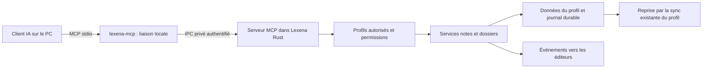

# MCP local pour Lexena — conception

Date : 5 novembre 2026. Statut : proposition de conception, sans implémentation produit.

## 1. Intention et périmètre

Permettre à une IA utilisée sur le PC de consulter et de gérer les données de Lexena par MCP. Le premier usage est la lecture, la création, l'ajout de contenu, la modification et la suppression de notes, avec leurs dossiers. L'architecture doit ensuite accueillir l'historique de transcription et d'autres fonctions de l'application.

Exigences exprimées par l'utilisateur :

- Connexion exclusivement locale au logiciel installé sur le PC ; aucun accès à distance.
- Prise en compte des profils, notamment « perso » et « work ».
- L'IA doit demander quel profil utiliser lorsqu'il existe un doute.
- Le MCP doit pouvoir s'étendre au-delà des notes.
- La fonction doit être distribuée avec Lexena à tous ses utilisateurs, sans téléchargement ou installation technique supplémentaire ; un changement de PC ne doit pas imposer de reconstruire l'intégration.

Les choix détaillés ci-dessous sont des recommandations de conception, et non des préférences déjà validées par l'utilisateur. Ils permettent de préparer une implémentation sans ouvrir de service distant.

## 2. État réel du dépôt

Constats vérifiés dans le code, qui précisent ou actualisent le résumé d'AGENTS.md :

| Sujet | Existant | Conséquence |
| --- | --- | --- |
| Profils | `src-tauri/src/profiles.rs`, `commands/profiles.rs`, manifeste `profiles.json`, ID local stable au renommage | Utiliser l'ID local, jamais le nom ni le `cloud_profile_id`, pour adresser le MCP local. |
| Chemins | Les notes, dossiers et transcriptions résolvent implicitement le profil actif | Introduire des services recevant un profil validé explicitement ; ne pas changer le profil affiché pour servir une requête. |
| Notes | `notes/<uuid>/note.json` + `content.html`, `NoteMeta`, suppression logique `deleted_at`, indicateur `local_only` | Conserver le format lisible et la compatibilité ; prévoir reprise sur interruption et restauration indépendante de la purge sync. |
| Concurrence | `update_note` écrit contenu puis métadonnées, sans révision attendue | Le MCP ne peut pas appeler ces commandes directement sans protection contre l'écrasement. |
| Éditeur | TipTap, sauvegarde différée de 500 ms dans `useNotesEditorInstance.ts` | Une révision disque ne suffit pas : tenir compte du texte encore présent uniquement dans l'éditeur. |
| Fenêtres détachées | `useDetachedNote.ts`, `useDetachedNotesBridge.ts`, événements `note-detached-updated` et `note-remote-updated` | Étendre l'invalidation aux deux formes d'éditeur, avec profil et révision dans chaque événement. |
| Sync | Les wrappers TS `notes-store.ts` / `folders-store.ts` enfilent les opérations ; queue et gate liés au profil actif | Une écriture Rust MCP seule ne produit pas une synchronisation fiable, surtout sur un profil inactif. |
| Historique | `src-tauri/src/transcriptions.rs` stocke des JSON sous le profil | L'extension historique doit s'appuyer sur ce stockage actuel, sans partir du principe qu'il est encore dans IndexedDB. |
| Taille cloud | `src/lib/sync/note-size.ts` : 3 145 728 octets UTF-8 | Réutiliser cette règle pour l'éligibilité sync ; ne pas la présenter comme une limite générale du stockage local existant. |
| HTML | `src/lib/sharing/render-html.ts` dépend d'un DOM navigateur | Ne pas l'importer dans Rust ou dans le programme de liaison ; prévoir une politique HTML compatible TipTap côté serveur. |

## 3. Architecture retenue

**Choix recommandé :** un serveur MCP dans le processus Rust de Lexena, utilisant le SDK officiel `rmcp`, et un petit exécutable `lexena-mcp` lancé par le client IA. Celui-ci relaie les messages entre ses flux standard et Lexena. Il ne lit ni n'écrit les données métier.

Sous Windows, l'IPC privé utilise un named pipe avec ACL explicite limitée à l'utilisateur Windows et refus des clients distants. Aucun socket TCP, endpoint HTTP, port LAN ou tunnel. Le nom du pipe est dérivé d'un identifiant d'installation ; il n'est pas une preuve d'autorisation. Le protocole MCP conserve son framing standard JSON-RPC délimité par lignes après un échange privé d'authentification borné.

L'exécutable de liaison et la bibliothèque IPC sont des crates Rust autonomes, sans dépendance Tauri, audio ou Whisper. Le serveur utilise le transport AsyncRead/AsyncWrite du SDK. Cela évite de lancer une seconde instance Tauri pour chaque client et garde un seul propriétaire des fichiers. L'IPC est abstrait pour permettre ultérieurement un socket Unix local ; Windows est la cible d'acceptation initiale, les autres plateformes ne doivent pas être annoncées comme supportées sans validation.

Alternatives examinées :

| Option | Intérêt | Décision |
| --- | --- | --- |
| MCP indépendant accédant directement aux fichiers | Fonctionne avec Lexena fermé | Écarté : second écrivain, concurrence, sync et règles métier dupliquées. |
| HTTP sur localhost dans Lexena | Pratique pour certains clients | Écarté du premier périmètre : port et protections HTTP inutiles pour le besoin exclusivement local. |
| stdio + liaison IPC vers Lexena | Aucun port, données gérées par l'application | Retenu ; nécessite que Lexena fonctionne, éventuellement masqué dans le tray. |

Un client IA doit pouvoir lancer un serveur MCP stdio sur le même PC. Un produit ne supportant que des serveurs distants n'est pas compatible avec ce périmètre. « MCP local » décrit le transport vers Lexena : si l'utilisateur choisit un modèle cloud, les contenus retournés peuvent être transmis par son client IA à ce modèle. L'interface doit l'expliquer simplement lors de la connexion.

**Présentation utilisateur :** « stdio » est un mode de communication, pas un logiciel à installer. La liaison fait partie de la distribution Lexena et se met à jour avec elle ; aucun téléchargement séparé, Node, Python, Cargo ou commande de compilation n'est demandé à l'utilisateur final. Tous les utilisateurs de la version compatible disposent du même écran MCP local, sans obligation de compte cloud pour accéder à leurs données locales.

## 4. Cycle de vie et connexion

1. Le MCP est désactivé par défaut. L'utilisateur l'active dans **Réglages → Intégrations → MCP local**.
2. Il crée une connexion nommée et choisit ses profils et permissions. Aucune création de connexion ou extension de droits par les outils MCP eux-mêmes.
3. Lexena crée un ID public et un secret aléatoire de 256 bits par connexion. Le secret réside dans le coffre système ; la configuration exportée ne contient que l'ID et le chemin du programme de liaison. Échec fermé si le coffre n'est pas disponible.
4. La configuration fournie au client lance `lexena-mcp --connection <id>`. Ne pas modifier automatiquement les fichiers de configuration de logiciels tiers.
5. La liaison authentifie le serveur local avant d'échanger des données métier. Utiliser une bibliothèque de cryptographie maintenue pour une preuve mutuelle HMAC-SHA256 avec nonces aléatoires, rôles distincts et version de protocole dans le transcript ; jamais transmettre le secret en clair. Vérifier aussi le PID du serveur du pipe et son chemin d'installation attendu. Tester l'usurpation du nom de pipe.
6. Les droits sont vérifiés au moment de chaque appel. Une révocation ou désactivation ferme les connexions et empêche les appels suivants ; une opération déjà durablement validée peut finir et reste visible dans le journal.
7. Si Lexena est fermé, retourner un diagnostic clair et un code de sortie non nul ; ne pas démarrer un moteur de fichiers autonome. Si Lexena est masqué dans le tray, le MCP fonctionne.
8. Pendant la récupération initiale, un changement de format ou la fermeture de l'application, les nouvelles requêtes sont refusées proprement. Une perte de liaison ne doit pas provoquer une relance automatique d'une mutation avec une nouvelle identité d'opération.

La configuration MCP et les autorisations sont **locales au compte OS et à son installation Lexena déclarée**, hors des préférences synchronisées et hors des profils. Elles ne suivent pas les sauvegardes exportées vers le cloud. Le dépôt utilise un app-data et un single-instance communs : la V1 prend en charge une seule installation Lexena active par compte Windows, pas deux serveurs indépendants portable/installé.

Un descripteur privé `mcp/endpoint.json`, écrit atomiquement et protégé par ACL, contient l'ID d'installation, le nom du pipe, le chemin canonique du serveur attendu et la version IPC. La liaison le lit avant authentification, puis vérifie sa cohérence avec sa propre installation et le PID du serveur. Ce descripteur n'est pas un secret ni une autorisation. Une autre installation déjà ouverte provoque un diagnostic explicite ; ne pas explorer d'autres pipes ou chemins pour la contourner. Un transfert d'installation doit être fait dans l'UI locale avec nouvelle configuration cliente.

Après réinstallation ou déplacement d'une version portable, régénérer la configuration de liaison si nécessaire. Une mise à jour standard conserve les connexions locales mais met à jour les deux exécutables ensemble. Avant installation d'une mise à jour, Lexena passe le MCP en maintenance, fait terminer les commits commencés puis fermer les liaisons afin de libérer les exécutables Windows. Si un processus garde le binaire verrouillé, demander sa fermeture avant installation au lieu de promettre un remplacement impossible. Conserver l'EXE portable seul existant et fournir en plus un ZIP portable MCP avec `lexena.exe`, la liaison et un manifeste de version commune ; l'EXE seul ne promet pas le MCP.

Limite de confiance : ces protections séparent les connexions autorisées et les comptes OS, mais ne constituent pas une isolation forte contre un logiciel malveillant exécuté sous le même compte Windows, capable d'utiliser le même coffre et de modifier les fichiers de l'utilisateur.

### Parcours d'installation et de changement de PC

Sur un premier PC : installer Lexena normalement, ouvrir MCP local, choisir les profils/droits puis copier ou importer la configuration fournie dans un client IA compatible. Les termes de transport restent dans l'aide avancée ; l'écran principal dit « Connecter mon IA » et n'invite pas à installer un logiciel « MCP stdio ».

Sur un nouveau PC :

1. Installer Lexena ; la liaison est déjà comprise dans l'installation.
2. Récupérer les données : se connecter au même compte et importer les profils cloud déjà synchronisés, ou restaurer une copie locale compatible si ces données n'étaient pas synchronisées.
3. Créer l'autorisation MCP sur ce PC et fournir la nouvelle configuration au client IA. Aucune modification manuelle de code ou recompilation ; la configuration utilise les nouveaux chemins et IDs locaux de profils.

Ce qui doit être distingué dans l'aide :

| Élément | Comportement |
| --- | --- |
| Notes/dossiers/snippets/dictionnaire et préférences prises en charge par la sync | Récupérables pour les profils effectivement synchronisés, via le compte et l'import de profils existant ; ne pas promettre que tout revient automatiquement au simple login. |
| Notes `local_only`, notes non envoyées, historique des transcriptions et audio | Non transférés par la sync actuelle ; garder une sauvegarde locale de l'ancien PC et vérifier sa restauration avant de l'effacer. |
| Modèles de transcription locaux | Fichiers sous l'app-data, transférables par une copie locale complète ou à retélécharger ; pas de transfert cloud automatique. |
| Autorisations MCP, secret du coffre et chemins de programmes | Recréés localement ; pas de copie automatique d'un droit d'accès IA d'un PC à l'autre. |
| Session du compte et paramètres dépendant du matériel | Nouvelle connexion et vérification du microphone nécessaires selon le poste ; ce n'est pas une reconstruction des notes ou du MCP. |

Constat actuel à ne pas masquer : `src/lib/sync/backups.ts` capture les notes du profil actif mais charge encore certains stores à des chemins racine. Ce backup JSON n'est donc pas à présenter comme un export complet multi-profil validé. L'export GDPR cloud n'est pas non plus une sauvegarde complète du PC. Une copie locale à application complètement quittée doit être conservée avant migration ; la restauration complète, les chemins audio absolus et les versions doivent être vérifiés sur le nouveau poste. Un assistant d'export/import complet éventuel constitue un chantier distinct, pas un prérequis caché à l'installation du MCP.

## 5. Règles de profil et demandes de clarification

Règles obligatoires côté serveur :

- Chaque appel portant sur une note ou un dossier contient un `profile_id` local explicite et vérifié dans le manifeste **et** dans les droits de la connexion.
- Le profil actif dans l'interface n'est jamais un défaut implicite pour le MCP.
- Les réponses et références d'objets incluent `profile_id`, `profile_name`, ID de l'objet et révision. Une référence d'objet ne vaut pas autorisation.
- Les dossiers, liens internes et notes doivent appartenir au même profil. Aucun déplacement ou copie entre profils en V1.
- Listes, recherche, ressources et erreurs ne révèlent aucun objet ni nom de profil non autorisé. Une lecture non autorisée d'un objet est indiscernable d'un objet inexistant.
- Un renommage conserve l'ID ; une suppression invalide les appels en cours avant leur commit et retire le profil des connexions. Un changement de profil dans l'UI ne change pas la cible d'un appel déjà validé.
- L'outil de contexte expose le profil actif seulement s'il est autorisé, comme information d'affichage, sans le sélectionner pour les futurs appels.

**Configuration conseillée :** deux connexions distinctes, `Lexena perso` et `Lexena work`, chacune limitée à son profil. Une connexion multi-profil reste possible par choix explicite. Les nouveaux profils ne sont jamais ajoutés automatiquement à un grant existant.

Comportement attendu de l'IA :

| Situation | Comportement |
| --- | --- |
| « Ajoute ceci à ma note Projet dans work » | Résoudre work et la note dans ce profil, puis exécuter selon les permissions. |
| « Ajoute ceci à Projet » sans profil établi | Demander « Dans le profil perso ou work ? » avant d'accéder au contenu. |
| Le profil a été explicitement établi dans la conversation | Réutiliser cet ID, en l'envoyant à chaque appel ; redemander si l'utilisateur change de contexte ou si la référence devient ambiguë. |
| Plusieurs notes portent le même titre dans le profil choisi | Présenter titres, dossier et date autorisés ; faire choisir avant modification. |
| Un seul profil est autorisé à la connexion | L'IA peut l'utiliser en l'indiquant, sauf si la demande vise explicitement un autre profil, auquel cas elle signale l'absence d'accès. |

Descriptions des tools, instructions du serveur et exemples de configuration portent cette politique. Si le client annonce l'elicitation MCP, proposer le choix avec cette capacité ; sinon, l'IA pose une question dans la conversation. Refus/annulation : aucun effet de bord.

**Limite à rendre explicite :** le serveur impose un ID et une permission, mais ne peut pas connaître le doute interne du modèle. Un modèle qui fournit un mauvais ID pourtant autorisé ne peut pas toujours être détecté. Les connexions limitées à un profil et les tests de conversations réduisent ce risque ; aucune promesse d'infaillibilité par une simple instruction au modèle.

## 6. Surface MCP V1

Noms d'outils proposés, bornés et stables. Les schémas complets seront générés depuis les types Rust, versionnés et vérifiés par tests de contrat.

| Outil | Arguments métier principaux | Permission |
| --- | --- | --- |
| `lexena_get_context` | aucun | contexte sans contenu, capacités et état de connexion |
| `lexena_list_profiles` | aucun | métadonnées des profils autorisés |
| `lexena_list_folders` | `profile_id`, `cursor`, `limit` | `notes.read` |
| `lexena_list_notes` | `profile_id`, filtres dossier/favori/date, `cursor`, `limit` | `notes.read` |
| `lexena_search_notes` | `profile_id`, `query`, filtres, `cursor`, `limit` | `notes.read` |
| `lexena_get_note` | `profile_id`, `note_id`, `format`, `cursor`, `limit` | `notes.read` |
| `lexena_create_note` | `profile_id`, `content`, `format`, `folder_id?`, `operation_id` | `notes.write` |
| `lexena_append_to_note` | `profile_id`, `note_id`, `content`, `format`, `expected_revision`, `operation_id` | `notes.write` |
| `lexena_edit_note` | `profile_id`, `note_id`, remplacement textuel exact unique, `expected_revision`, `operation_id` | `notes.write` |
| `lexena_set_note_metadata` | `profile_id`, `note_id`, `folder_id?`, `favorite?`, `expected_revision`, `operation_id` | `notes.write` |
| `lexena_replace_note_content` | `profile_id`, `note_id`, HTML complet, `read_token`, `expected_revision`, `operation_id` | `notes.replace` |
| `lexena_delete_note` | `profile_id`, `note_id`, `expected_revision`, `operation_id` | `notes.delete` |
| `lexena_restore_note` | `profile_id`, `note_id`, `snapshot_id`, `expected_revision`, `operation_id` | `notes.write` |
| `lexena_list_note_versions` | `profile_id`, `note_id`, `cursor`, `limit` | `notes.read` |
| `lexena_create_folder` | `profile_id`, `name`, `icon?`, `operation_id` | `notes.write` |
| `lexena_update_folder` | `profile_id`, `folder_id`, `name?`, `icon?`, `expected_revision`, `operation_id` | `notes.write` |
| `lexena_delete_folder` | `profile_id`, `folder_id`, `expected_revision`, `operation_id` | `notes.delete` |

`notes.write` exige aussi `notes.read`. Suppression et remplacement intégral sont désactivés par défaut ; l'utilisateur peut les autoriser durablement par connexion. Ne pas imposer une confirmation répétitive pour chaque ajout déjà autorisé. Une suppression de dossier détache les notes vers la racine, sans supprimer leur contenu, conformément au comportement existant. Le titre d'une note reste dérivé de sa première ligne comme dans l'éditeur : le modifier passe par une édition de cette ligne, sans inventer un titre indépendant.

Pas d'outil générique `invoke`, `execute`, SQL, terminal, chemin arbitraire ou accès brut au Store. Pas de création/suppression/changement de profil via MCP V1. Les capacités futures sont des modules distincts, explicitement autorisés.

### Contrat commun

- `profile_id` requis dans le schéma des outils métier. Un argument absent est une erreur de paramètres JSON-RPC avec `data.code = PROFILE_REQUIRED` et une indication de clarification, avant toute recherche.
- Résultats structurés (`structuredContent`) et équivalent textuel compact ; `outputSchema` vérifiable ; versions de protocole négociées par le SDK, sans réimplémenter MCP.
- Les erreurs métier sont des résultats MCP `isError: true`, avec `code`, `message`, `retryable`, `next_action` et détails autorisés. Codes : `NOT_FOUND`, `PERMISSION_DENIED`, `REVISION_CONFLICT`, `EDITOR_BUSY`, `AMBIGUOUS_MATCH`, `UNSUPPORTED_CONTENT`, `CONTENT_TOO_LARGE`, `CURSOR_EXPIRED`, `IDEMPOTENCY_CONFLICT`, `HISTORY_FULL`, `RECOVERY_REQUIRED`.
- `operation_id` UUID fourni par le client, unique par connexion et intention, requis sur chaque mutation. Même ID + mêmes arguments normalisés : même résultat, aucune seconde modification. Même ID + autres arguments : `IDEMPOTENCY_CONFLICT`. Conserver les reçus 30 jours ; passé ce délai, ne pas relancer une opération incertaine sans relire l'état.
- La déduplication consulte le reçu après contrôle des droits actuels, avant de refaire les préconditions de mutation (révision, jeton de lecture, état éditeur). Un retry d'une opération déjà commise peut ainsi retrouver son résultat malgré une révision changée ou un jeton expiré. `expected_revision` est un jeton opaque local, différent de `updated_at` et non synchronisé.
- Une lecture HTML paginée délivre un `read_token` seulement après livraison séquentielle de tous les segments d'une même révision. Le jeton est lié à la connexion, au profil, à la note et à la révision, expire après 10 minutes et est invalidé par une mutation. Le remplacement intégral l'exige en plus de la révision ; cela prouve la livraison de l'HTML complet au client, pas la compréhension du document par le modèle.
- Pagination par curseur opaque lié à connexion, profil, filtres et version de collection ; défaut 20, maximum 100 éléments. Une mutation qui invalide la pagination retourne `CURSOR_EXPIRED` plutôt que dupliquer silencieusement des résultats.
- Recherche initiale lexicale sur texte extrait du HTML, Unicode normalisé, insensible à la casse ; titres et extraits bornés. Pas de dépendance à un modèle IA ni d'index vectoriel pour V1.
- `get_note` retourne du texte par défaut, du Markdown sur demande avec indicateur de perte, ou le HTML stocké pour préserver la fidélité. Segments de lecture : 32 768 octets UTF-8 au plus, limites aux frontières Unicode ; titre/révision/références hors contenu, aucun chargement d'image distante. Les grandes images inline sont représentées par des marqueurs dans les vues texte/Markdown.
- Limite d'entrée MCP : 8 388 608 octets par message ; contenu HTML produit par une mutation : au plus 3 145 728 octets UTF-8. Cette limite prudente ne limite pas la lecture des notes locales existantes plus grandes. Pas de troncature silencieuse, pas de désactivation automatique de `local_only`.
- Maximum 8 liaisons simultanées, 4 requêtes métier en vol par connexion, délai 30 s pour une requête ordinaire ; fermeture/annulation avant commit sans mutation. Après le point de commit, finaliser la transaction et retrouver le résultat par `operation_id`.
- Les annotations MCP `readOnlyHint`, `destructiveHint`, `idempotentHint` décrivent le comportement, sans remplacer l'autorisation serveur. Ne pas annoncer l'append comme intrinsèquement idempotent sans préciser le rôle de `operation_id`.

Ressources à proposer après les tools : `lexena://profiles/<profile_id>/notes/<note_id>` et `lexena://profiles`, avec les mêmes contrôles et limites. Les identifiants d'URI ne sont pas des chemins disque. Ne pas faire de dépendance V1 aux prompts, au sampling, aux souscriptions ou à l'elicitation ; ces fonctions sont optionnelles selon les clients.

## 7. Écriture, HTML et protection du travail en cours

### Services et validation

Extraire des opérations métier `notes` et `folders` vers un service recevant un `ProfileScope` construit après vérification. Les opérations UI non différées capturent leur profil une seule fois à l'entrée. Les éditeurs et la sync utilisent un contexte lié au profil dès leur chargement, pas une résolution du profil actif au moment où une sauvegarde retardée arrive. Le serveur MCP ne modifie jamais `AppState.active_profile_id`.

Valider les IDs de notes/dossiers en UUID et les profils par le manifeste avant construction de chemin ; vérifier le confinement réel et refuser les reparse points/symlinks sortants. Appliquer les contrôles aux commandes publiques réutilisées, aux imports et aux ressources, pas seulement aux tools MCP.

### Édition ciblée et formats

- Création et ajout acceptent `text` ou un sous-ensemble documenté de Markdown, converti en HTML compatible TipTap par Rust. Pas de HTML libre injecté via un champ texte.
- L'ajout conserve intégralement le HTML existant et ajoute des blocs ; il n'effectue pas un aller-retour Markdown sur toute la note.
- L'édition ciblée reçoit `old_text` et `new_text` en texte brut et remplace une occurrence exacte unique **dans un même nœud texte HTML**. Zéro occurrence : `NOT_FOUND` ; plusieurs : `AMBIGUOUS_MATCH` ; correspondance traversant plusieurs nœuds : `UNSUPPORTED_CONTENT`. Échapper le nouveau texte ; préserver les autres nœuds, liens, images et attributs TipTap. Pas de regex arbitraire.
- Le remplacement intégral accepte seulement `format: html`, avec permission spécifique et sauvegarde préalable. Il exige une lecture complète de la version HTML concernée ; ne jamais reconstruire une note riche à partir d'une vue Markdown déclarée avec pertes.
- Définir une allowlist HTML côté Rust basée sur les extensions réelles de l'éditeur : tableaux, listes de tâches, blocs de code, liens internes, styles contrôlés et images raster data-URI. Refuser scripts, handlers, iframes, `javascript:`, `file:`, SVG actif et URLs locales. Ne pas supprimer silencieusement un élément non supporté lors d'une réécriture : retourner une erreur. Aucun fetch d'URL par le serveur MCP.
- Dériver le titre de la première ligne visible avec la même règle que le frontend ; tests de parité FR/EN et Unicode. Les références à d'autres notes ne sont ni suivies ni retournées sans les permissions appropriées.

### Révisions et éditeurs ouverts

Chaque mutation, y compris UI et import distant, renouvelle une révision locale opaque. La comparaison de la révision et l'écriture s'effectuent sous le même verrou de profil. Les timestamps restent destinés à la synchronisation existante, pas au contrôle de concurrence MCP.

Les éditeurs principaux et détachés enregistrent leur propriétaire, profil, note, génération de session, révision chargée et état dirty auprès de Rust. Chaque lecture, barrière et sauvegarde UI transporte ce contexte ; `switch_profile` invalide la génération sortante avant de recharger les fenêtres. Une commande retardée est refusée, jamais réinterprétée dans le nouveau profil, même si une restauration a placé le même UUID de note dans les deux profils. Au premier changement TipTap, transmettre une barrière `begin_note_edit(profile_id, note_id, session_generation, base_revision)` avant la sauvegarde différée ; le service sérialise cette barrière et les mutations externes. Une mutation MCP refuse un éditeur dirty ou non réactif (`EDITOR_BUSY`). Pour un éditeur propre, le service demande une brève préparation, l'éditeur suspend ses mutations puis accuse réception ; la mutation est ensuite validée et l'éditeur recharge la nouvelle révision avant de reprendre.

Le point de sérialisation est l'acquittement serveur de la barrière d'édition. Si une frappe locale arrive pendant cette course, conserver le buffer utilisateur ; la sauvegarde attendue sur l'ancienne révision échoue, conserve le brouillon et présente un conflit. Ne jamais recharger ou sauvegarder aveuglément un buffer dirty. Une fenêtre fermée ou une préparation sans réponse expire en 2 s et refuse l'écriture MCP ; ne pas considérer une expiration comme une preuve que l'éditeur est propre.

Les événements `note-changed` / `folder-changed` incluent `profile_id`, ID, `revision`, `operation_id`, `source` et type de mutation. Les fenêtres filtrent par profil. Les événements accélèrent le rafraîchissement ; la récupération et la sync ne dépendent pas de leur livraison.

### Durabilité et restauration

Conserver les fichiers actuels. Pour les mutations, un journal transactionnel local contient la liste des entités affectées avec leur état après opération, leurs révisions, le reçu d'idempotence et les intentions de sync. Une suppression de dossier inclut dans la même transaction son tombstone et le détachement de chacune de ses notes, avec invalidation et intention sync correspondantes. Écrire durablement le journal avant d'appliquer les fichiers ; les lecteurs prennent le verrou et ne voient pas de paire contenu/métadonnées partielle. Au redémarrage, terminer les transactions journalisées avant de servir UI, sync ou MCP. Une écriture partielle place le profil en récupération, sans continuer à servir des résultats incohérents. Utiliser les primitives atomiques adaptées à Windows ; un simple renommage portable ne suffit pas à promettre l'atomicité de deux fichiers.

Avant une modification MCP de contenu ou une suppression, conserver un snapshot privé de la version précédente, hors du dossier que la purge sync supprime. Rétention 30 jours, budget 256 Mio par profil ; expirer les snapshots hors délai, puis refuser la mutation avec `HISTORY_FULL` si le budget ne permet pas de conserver le snapshot demandé. Afficher la date d'expiration. La V1 ne promet pas un historique complet des frappes utilisateur.

Suppression logique uniquement via MCP. La restauration d'une note supprimée, même après purge locale du tombstone, réutilise l'ID si absent ou toujours supprimé ; elle refuse d'écraser une note active et réapplique une révision fraîche. Elle préserve `local_only` et peut réenfiler un upsert lorsque la sync du profil est activée. Aucun outil de purge définitive ou de suppression en masse en V1.

## 8. Articulation avec la synchronisation existante

**Le MCP ne se connecte à aucun service distant.** La synchronisation cloud éventuellement activée dans Lexena conserve son fonctionnement existant. Exposer une donnée par MCP ne doit ni activer la sync ni modifier les préférences de confidentialité d'une note.

Ajouter une outbox durable Rust par profil pour les mutations locales de notes/dossiers, alimentée par le service commun UI/MCP. Transférer la persistance de `sync-queue.json` à un unique repository Rust d'écriture atomique : `queue.ts` conserve son API et son mutex mais appelle ce repository, sans garder en parallèle un propriétaire Tauri Store pour ce fichier. Les autres stores restent inchangés. Le snapshot de queue contient entrées, DLQ, révision et watermark d'import outbox.

Le journal de mutation conserve une séquence par profil. Un consommateur TS, actif seulement pour le profil réellement chargé, importe les intentions vers la queue existante, puis acquitte l'outbox **après** sauvegarde atomique des entrées et du watermark correspondant. La queue reçoit aussi un identifiant déterministe dérivé du profil et de la mutation. Le watermark persiste après consommation des entrées : il permet de réacquitter Rust après un crash même si les entrées ont déjà été envoyées puis effacées. Un ID déterministe seul ne suffit pas à cette garantie. Migrer les wrappers notes/dossiers vers ce flux ; ne pas garder un second enqueue concurrent pour la même mutation. Les imports distants passent par les mêmes verrous/révisions mais n'engendrent pas de nouvel upsert local (éviter la boucle).

Lorsqu'un profil est inactif, ses modifications sont sauvegardées immédiatement ; sa sync reste en attente jusqu'à son prochain chargement. Le résultat MCP annonce `sync_state: deferred_profile_inactive`, `pending`, `disabled`, `local_only` ou `too_large`, sans jamais prétendre que le cloud a déjà confirmé l'écriture. La V1 ne crée pas de synchroniseur de tous les profils en arrière-plan.

À l'activation/au chargement du profil, absorber les mutations locales et résoudre leurs intentions avant d'appliquer un pull susceptible de les écraser. Une mutation en outbox, dans la queue ou en DLQ protège l'entité locale contre un pull destructif tant qu'elle n'est pas confirmée côté cloud ou explicitement abandonnée via l'action de rejet DLQ existante ; un échec réseau ne lève pas cette protection. Différer l'application de cette entité distante et la relire lors d'un prochain pull après résolution de l'intention, puis réévaluer selon LWW. Ne pas créer de magasin de conflits ni d'écran de fusion manuelle dans ce lot. Un rejet DLQ indique que la prochaine réconciliation pourra réappliquer la version distante. L'acquittement d'import n'est pas une confirmation cloud. Préserver les règles `shouldPushNote`, `local_only`, taille UTF-8 et tombstones. Une suppression supplante un ancien upsert différé ; ne pas rejouer un snapshot ancien d'une note par-dessus son état actuel. Ordre serveur : `profile-upsert` confirmé, puis dossiers requis confirmés, puis notes, conformément aux FK existantes. Réessai/DLQ existants restent visibles ; un profil supprimé ne doit pas être recréé par une intention tardive.

La garantie de conflit de la V1 est locale : les modifications concurrentes provenant d'autres appareils conservent la politique LWW actuelle. Une collaboration distribuée sans perte demanderait un projet distinct. Aucun changement de schéma distant ni déploiement cloud nécessaire pour le socle MCP.

## 9. Permissions, interface et traçabilité

Dans la section MCP local : état activé/désactivé, connexions nommées, profils autorisés, droits lecture/écriture/suppression/remplacement, configuration à copier, test de liaison, dernière activité, révocation et rotation. Les changements s'appliquent uniquement depuis l'interface locale. Les notes `local_only` ne sont pas rendues accessibles par défaut : une option locale distincte `notes.local_only.read` autorise explicitement leur accès ; leur écriture exige aussi `notes.write`. Un outil ne peut pas modifier cette option ni la propriété `local_only`.

Journal d'activité local : horodatage, connexion, outil, profil ID, objet ID, résultat, durée, operation ID ; aucun contenu de note, recherche, secret, titre sensible ou texte dicté. Rétention 30 jours, rotation à 10 Mio ; métadonnées consultables dans Lexena, pas exportées automatiquement. L'historique de restauration contient du contenu et reçoit des droits disque privés, contrairement au journal d'activité minimal.

Les contenus de notes sont des données non fiables, même s'ils contiennent « ignore les instructions ». Le serveur n'exécute jamais ces instructions, n'élargit aucun droit et n'ouvre aucun lien. Les instructions MCP doivent expliquer cette distinction aux clients ; elles ne remplacent pas les permissions. Les outils cachés faute de permission sont également refusés à l'invocation directe.

## 10. Extensions après la V1

| Lot | Fonctionnalités | Conditions |
| --- | --- | --- |
| V1 | Notes/dossiers, profils explicites, historique de restauration, connexion stdio, permissions, sync cohérente | Livrable initial complet. |
| V1.1 | Liste/recherche/lecture des transcriptions, création ou ajout dans une note depuis une transcription | `transcriptions.read`, profil explicite ; pas d'audio brut ni chemin disque retourné. |
| V1.2 | Snippets et dictionnaire en lecture/écriture ; préférences non sensibles via allowlist | Respect des stores per-profile et sync ; jamais de clés API ou tokens. |
| V2 optionnelle locale | Statut applicatif, ouverture d'une note dans l'UI, contrôle d'enregistrement et commandes longues | Permissions séparées ; effets visibles, profil d'enregistrement stable, annulation, coûts cloud et insertion automatique explicités avant réalisation. |

L'enregistrement, le collage dans une autre application, le presse-papiers, le partage public de notes, la facturation, l'authentification, les clés, les mises à jour et la suppression d'un profil ne deviennent pas accessibles par l'ajout du MCP. Ils nécessiteraient chacun un contrat et une autorisation propres. Aucun serveur MCP distant n'est prévu, y compris dans la feuille de route.

## 11. Acceptation et livraison

- Depuis un client stdio sur le PC, créer, lire, ajouter, modifier, déplacer et supprimer/restaurer une note ; résultat identique dans l'UI et après redémarrage.
- Perso actif à l'écran + appel explicite work : seule la note work change, sans reload ni changement de profil UI.
- Argument de profil absent, profil non autorisé, référence d'objet d'un autre profil, nouveau profil et profil supprimé : aucun accès ni mutation indue.
- Rejouer deux fois un append après perte de connexion : un seul ajout, même résultat.
- Éditeur principal ou détaché dirty, course frappe/append et révision périmée : refus ou conflit visible, aucun texte utilisateur perdu.
- Crash entre journal/contenu/métadonnées/outbox/reçu, puis redémarrage : état complet récupéré et pas de doublon.
- Profil inactif ou réseau indisponible : mutation locale conservée ; au chargement, reprise sync sans contamination et sans résurrection de tombstone.
- Note local-only, HTML riche, images base64, Unicode et limite exacte 3 145 728 octets : conservation ou erreur explicite, sans perte silencieuse.
- Autre compte Windows, client distant de named pipe, pipe usurpé, connexion révoquée et charge excessive : refus contrôlé.
- Lexena fermé/tray, plusieurs clients, changement de profil pendant requête, mise à jour et version portable : diagnostics et comportements documentés.
- PC Windows neuf sans environnement de développement : installer Lexena suffit pour disposer de la liaison. Après récupération des profils, recréer l'autorisation MCP et tester une note par profil ; aucun secret, chemin ou ID local de l'ancien PC ne doit être réutilisé implicitement.
- Valider l'installateur et le binaire de liaison avec le build Tauri complet ; ne jamais lancer `pnpm tauri dev` automatiquement.

Livraison progressive : feature flag désactivé, tests sur profils dédiés et données synthétiques, bêta locale, puis activation volontaire en version stable. Revenir en arrière désactive l'écoute et conserve les notes ; ne jamais effacer l'outbox pour masquer une erreur. Les versions comprenant le nouveau garde de format refusent un profil nécessitant une récupération incompatible. Les binaires antérieurs ne connaissent pas ce garde et ne peuvent pas être empêchés techniquement de lire les anciens chemins conservés : leur retour arrière n'est supporté qu'avec une sauvegarde compatible prise avant migration, application fermée. Ne pas promettre une protection rétroactive de ces anciens lecteurs.

## 12. Références techniques vérifiées le 5 novembre 2026

Ces références étayent les mécanismes ; les limites et politiques produit sont des choix du présent document.

- [Spécification MCP stdio](https://modelcontextprotocol.io/specification/2026-07-28/basic/transports/stdio) : sous-processus local, framing, stdout réservé au protocole.
- [SDK Rust officiel](https://github.com/modelcontextprotocol/rust-sdk) et [transport AsyncRead/AsyncWrite](https://docs.rs/rmcp/latest/rmcp/transport/index.html) : réutilisation du protocole et support d'un flux IPC.
- [Tools MCP](https://modelcontextprotocol.io/specification/2026-07-28/server/tools) : schémas, résultats structurés et annotations.
- [Elicitation MCP](https://modelcontextprotocol.io/specification/2026-07-28/client/elicitation) : clarification facultative selon les capacités du client.
- [Tokio named pipes](https://docs.rs/tokio/latest/tokio/net/windows/named_pipe/struct.ServerOptions.html) : attributs de sécurité, première instance et refus des clients distants.
- [Microsoft — sécurité des named pipes](https://learn.microsoft.com/en-us/windows/win32/ipc/named-pipe-security-and-access-rights) : ne pas utiliser les ACL par défaut.
- [Tauri — binaires externes](https://v2.tauri.app/develop/sidecar/) : packaging par target du programme de liaison ; celui-ci est lancé par le client IA, pas par un outil shell du frontend.

Version MCP de référence actuelle : 2026-07-28. Évaluer une version publiée du SDK dans le spike, la verrouiller dans Cargo.lock et tester aussi la compatibilité 2025-11-25 annoncée par le SDK. Ne pas copier une dépendance flottante depuis la branche principale.

## 13. Contrats figés par le lot 0

Les choix SDK, cycles de vie MCP 2026-07-28/2025-11-25, framing IPC privé v1, dépendances, fixtures synthétiques et packaging sont détaillés dans [implementation-decisions.md](../../mcp/implementation-decisions.md). Le spike est jetable et ne remplace ni les protections du lot 5 ni la validation installateur du lot 9. Le protocole actuel utilise server/discover et les métadonnées par requête ; initialize reste propre à la compatibilité 2025-11-25.
